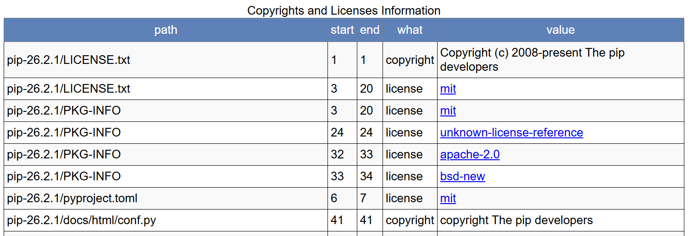

# 第三周作业 · 《开源创新思维》平时作业报告 —— 开源合规与许可证

**课程信息**

| 课程 | 姓名 | 学号 | 班级 | 指导教师 | 学期 | 院校 |
|:---:|:---:|:---:|:---:|:---:|:---:|:---:|
| 开源创新思维 | 朱胤陈 | F25015349 | F250118 | 祝欣蓉 | 2026-2027 秋季学期 | 上海杉达学院 |

> 本目录为课程**第三周作业**的归档。原始提交文档见：[F25015349-朱胤陈-开源合规与许可证.docx](./F25015349-朱胤陈-开源合规与许可证.docx)。由于 GitHub 无法直接预览 `.docx`，下方提供内容的 Markdown 版本，便于在线阅读。

## 作业信息

| 项目 | 内容 |
|---|---|
| 课程名称 | 开源创新思维 |
| 姓名 | 朱胤陈 |
| 学号 | F25015349 |
| 班级 | F250118 |
| 指导教师 | 祝欣蓉 |
| 开设学期 | 2026-2027 秋季学期 |
| 开设时间 | 第 1 周 —— 第 16 周 |
| 报告日期 | 10 月 17 日 |
| 学校 | 上海杉达学院 |

---

## 一、选取的开源项目：pip 26.2.1

pip 是 Python 官方打包机构 PyPA 维护的包安装与管理工具，采用 **MIT 许可证**，是 Python 生态中最基础的基础设施之一。本次选取 PyPI 发布的 **pip 26.2.1** 源码包（`pip-26.2.1.tar.gz`，解压后共 574 个文件、66 个目录，合计 6.06 MB）作为扫描对象。

选择该项目的理由有两点：

1. pip 在 `src/pip/_vendor` 目录下以源码内置（vendoring）方式打包了 **18 个第三方组件**：cachecontrol、certifi、distlib、distro、idna、msgpack、packaging、platformdirs、pkg_resources、pygments、pyproject_hooks、requests、resolvelib、rich、tomli、tomli_w、truststore、urllib3。这些组件分别采用 MIT、Apache-2.0、BSD-2-Clause、BSD-3-Clause、ISC、MPL-2.0、Python-2.0 等许可证，是典型的“多许可证共存”对象，能够较全面地检验工具的识别能力。
2. 项目自带 `vendor.txt` 与 `bom.cdx.json`（CycloneDX 格式 SBOM），可作为人工核对的“真值”，用于评价工具检测结果的准确性。

## 二、许可证合规工具的选择与安装

选用 **ScanCode Toolkit 32.5.0**（Apache-2.0 许可证），它是由 AboutCode 社区维护的软件组成分析（SCA）工具，可检测源代码与二进制文件中的许可证、版权声明、包清单和依赖关系，支持输出 JSON、HTML、SPDX、CycloneDX 等格式，便于后续集成到 CI 流程。

**安装环境**：Windows 10 企业版（10.0.19045，64 位）、Python 3.14.7、pip 26.2.1。

**安装步骤**：

1. 执行 `python -m venv scvenv` 建立独立虚拟环境，避免污染系统 Python 环境；
2. 执行 `pip install scancode-toolkit`，自动安装 lxml、license-expression、typecode、extractcode、plugincode 等 80 余个依赖，虚拟环境最终占用约 590 MB；
3. 执行 `scancode --version` 验证，输出 ScanCode version 32.5.0、ScanCode Output Format version 4.1.0、SPDX License list version 3.27。

**安装过程中遇到的问题及解决**：

1. **依赖版本不兼容**。安装完成后首次执行 `scancode --version` 直接报错：`ValueError: did not find any pre_scan hooks in module plugincode.pre_scan`。排查发现 pip 自动安装了 pluggy 1.7.0，而 plugincode 32.0.0 在初始化时注册 hookspec 的方式与新版 pluggy 不兼容。执行 `pip install "pluggy==1.5.0"` 将 pluggy 降级后，命令恢复正常——此类工具对插件框架版本较敏感，安装时应锁定依赖版本。
2. **启动与扫描开销较大**。首次启动需要加载许可证规则库，setup 阶段耗时 3.71 秒；扫描 574 个文件共耗时 269.80 秒，平均 2.13 文件/秒，主要开销集中在许可证文本匹配环节。
3. **路径问题**。源码包解压到含中文或空格的目录时，命令行参数容易被截断或解析失败，因此统一解压到纯英文临时目录后再执行扫描。

## 三、工具输出的检测报告

执行命令：

```bash
scancode -clpi --json-pp pip-scan.json --html pip-scan.html --timeout 180 pip-26.2.1
```

其中 `-c` 检测版权、`-l` 检测许可证、`-p` 识别包信息、`-i` 输出文件信息；`--json-pp` 输出格式化 JSON，`--html` 生成可视化报告。

### 表 1  ScanCode 扫描概况

| 统计项 | 结果 |
|---|---|
| 扫描对象 | pip 26.2.1 源码包（6.06 MB） |
| 扫描资源 | 640 个（文件 574 个、目录 66 个） |
| 总耗时 | 277.68 s（扫描 269.80 s，输出 3.18 s） |
| 错误数 | 0 |
| 检出许可证的文件 | 86 个，占 15.0% |
| 未检出许可证的文件 | 488 个，占 85.0% |
| 许可证匹配数 | 148 处（置信度 100 的 110 处，低于 90 的 3 处） |
| 版权声明 | 73 条（去重后 32 条） |
| 识别出的包 | 8 个（pip 26.2.1；distlib 中 6 个 PE 文件 Simple Launcher 1.1.0.14） |

工具生成的 HTML 报告按“路径—起止行—类型—取值”逐条列出许可证与版权检测结果。



*图 1 ScanCode Toolkit 输出的 HTML 检测报告（局部）*

### 表 2  许可证表达式分布（按文件计数）

| 许可证表达式（SPDX） | 文件数 |
|---|---|
| MIT | 23 |
| Apache-2.0 | 21 |
| BSD-2-Clause | 17 |
| BSD-3-Clause | 13 |
| BSD-3-Clause OR Apache-2.0 | 8 |
| MIT AND Python-2.0 | 4 |
| Python-2.0 | 3 |
| Apache-2.0 AND BSD-2-Clause | 3 |
| MPL-2.0 | 1 |
| ISC | 1 |
| 其他组合（5 类） | 5 |

### 表 3  内置组件许可证检测结果

| 内置组件 | 文件数 | 检出许可证 |
|---|---|---|
| certifi | 6 | MPL-2.0 |
| requests | 21 | Apache-2.0 |
| cachecontrol | 14 | Apache-2.0 |
| distro | 5 | Apache-2.0 |
| msgpack | 5 | Apache-2.0 |
| urllib3 | 39 | MIT、Python-2.0 |
| rich | 79 | MIT |
| platformdirs | 11 | MIT |
| truststore | 8 | MIT |
| pyproject_hooks | 6 | MIT |
| pygments | 24 | BSD-2-Clause、BSD-3-Clause |
| packaging | 24 | BSD-3-Clause OR Apache-2.0、Apache-2.0 AND BSD-2-Clause |
| idna | 12 | BSD-3-Clause |
| distlib | 12 | MIT、Python-2.0 |
| resolvelib | 11 | ISC |
| tomli | 6 | MIT AND Python-2.0 |
| tomli_w | 4 | MIT |
| pkg_resources | 2 | MIT |

## 四、检测报告分析

### 4.1 主项目许可证识别准确

pip 根目录的 `LICENSE.txt` 被识别为 MIT，置信度 100；根目录 `pyproject.toml` 与 `PKG-INFO` 同样被识别为 MIT，并被归类到 pypi 包 pip 26.2.1。这说明工具不仅能匹配许可证原文，还能利用包元数据辅助判断，使包级结论保持一致。

### 4.2 文件级覆盖率偏低的原因

488 个未检出许可证的文件中，`.py` 文件 348 个、`.rst` 文件 68 个、`.md` 文件 42 个，其余为 `.exe`、`.toml`、`.pem` 等。原因是 pip 自身代码不在每个文件头部写许可证声明，只在根目录 `LICENSE.txt` 中集中声明，而 ScanCode 以文件为单位报告，因此大量文件显示“未检出”。这说明“未检出”不等于“无许可证”，合规判断必须结合包级结论与项目根的许可证文件，而不能只看文件级覆盖率。

### 4.3 与官方组件清单的对照

将检测结果与 pip 自带的 `vendor.txt` 逐一对照，18 个内置组件全部被扫描覆盖，主要判定与官方声明一致：certifi→MPL-2.0，resolvelib→ISC，requests、cachecontrol、distro、msgpack→Apache-2.0，idna→BSD-3-Clause，pygments→BSD-2/3-Clause，rich、urllib3、platformdirs、truststore→MIT，distlib→Python-2.0。同时也存在两类需要人工介入的偏差：

1. **组合表达式**。packaging 被判为“BSD-3-Clause OR Apache-2.0”“Apache-2.0 AND BSD-2-Clause”，tomli 的 4 个文件被判为“MIT AND Python-2.0”，`distlib/util.py` 被判为“Python-2.0 AND MIT”。这是因为这些文件内部同时含有多个许可证片段（例如从 CPython 移植的代码），工具按 SPDX 表达式聚合，具体适用哪一条仍需回到源码上下文确认。
2. **误报**。`vendor/packaging/licenses/__init__.py` 被判为 `LicenseRef-scancode-proprietary-license`（置信度 80）。该文件本身收录的是各种许可证的名称与文本，被文本匹配误判为“专有许可证”，属于典型的假阳性。本次置信度低于 90 的匹配共 3 处，均应人工复核。

### 4.4 许可证兼容性与合规义务

pip 以 MIT 对外发布，内置组件以宽松许可证为主，与 MIT 兼容，可以整体再分发，但须履行相应义务：

- **Apache-2.0**（requests、cachecontrol、distro、msgpack 及 packaging 部分文件）需保留 LICENSE 与 NOTICE（如有），并标注修改过的文件；
- **BSD-2/3-Clause**（pygments、idna、packaging）需保留版权声明和免责条款，BSD-3-Clause 还禁止以作者名义为衍生产品背书；
- **MIT 与 ISC**（rich、urllib3、platformdirs、truststore、tomli、resolvelib 等）需保留版权与许可声明；
- **MPL-2.0**（certifi）为文件级弱 copyleft，修改 certifi 源文件后须以 MPL-2.0 公开被修改文件，但不影响 pip 其余 MIT 代码；
- **Python-2.0**（distlib、`urllib3/util/ssl_match_hostname.py`、tomli 部分文件）需保留 PSF 许可证与版权声明。

总体来看，上述组合不构成许可证冲突，pip 仍可按 MIT 整体分发，核心义务是“保留声明、标注修改”。

### 4.5 风险与改进建议

1. **声明不完整**。85% 的文件没有文件级声明，若下游只复制单个模块到闭源项目，仅凭扫描结果无法确定该模块的许可证。建议在文件头加入 SPDX 标识符，例如 `# SPDX-License-Identifier: MIT`。
2. **二进制与资源文件**。distlib 中 6 个 `.exe` 被识别为 Simple Launcher 1.1.0.14，工具能识别 PE 文件及版本信息，但二进制内嵌的许可证无法可靠检出，需要以 SBOM 和上游声明补充。
3. **结果复核**。低置信度匹配与组合表达式必须人工确认，不能直接作为法律结论。
4. **流程化**。建议把 `scancode -clpi --json-pp` 接入 CI，每次发版自动生成 JSON 与 SPDX/CycloneDX 报告，并与 `vendor.txt`、`bom.cdx.json` 比对，一旦出现新增或变更组件即告警，同时在发布包内附带 `THIRD-PARTY-NOTICES` 文件。

### 4.6 工具局限性

ScanCode 基于文本特征匹配，无法判断动态链接、调用方式等实际使用场景，也不能替代法律意见；对于许可证声明集中在根目录的项目，文件级覆盖率天然偏低，应与包级检测、SBOM 交叉验证后再下结论。

## 五、评价表格

| 考核标准 | 得分 |
|---|---|
| （1）报告格式规范、语言通顺（10%） | |
| （2）质量标准分析合理（10%） | |
| （3）测试方法分析全面、合理（20%） | |
| （4）测试风险分析全面、合理（20%） | |
| （5）测试总体测试策略全面、合理（30%） | |
| （6）测试充分性判断标准合理（10%） | |

---

## 附：原始文件

- 提交文档：[F25015349-朱胤陈-开源合规与许可证.docx](./F25015349-朱胤陈-开源合规与许可证.docx)
- 报告截图：[media/report.png](./media/report.png)
